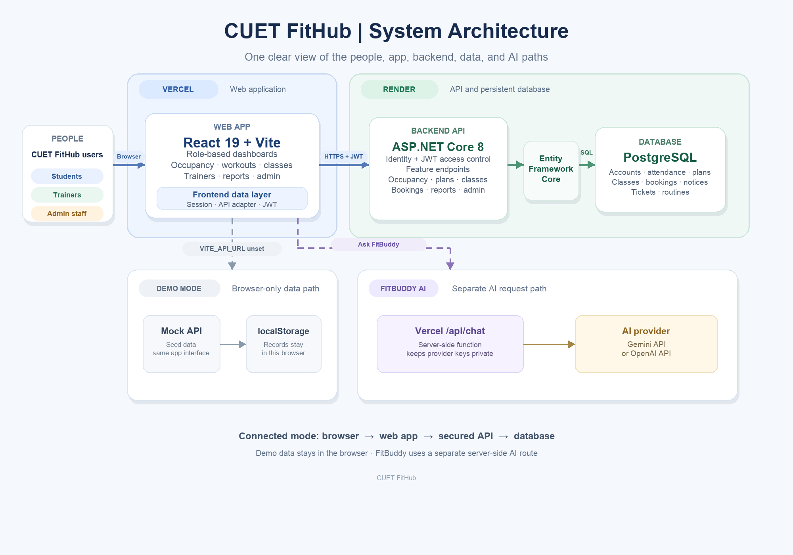

# CUET FitHub — System Architecture

The diagram reads left to right for the live application path: CUET users access the React + Vite web app, which calls the ASP.NET Core API. The API applies Identity/JWT access rules and feature logic, then uses Entity Framework Core to store persistent data in PostgreSQL.

The two lower paths show optional behavior: when `VITE_API_URL` is unset, the frontend uses its mock API and browser `localStorage`; FitBuddy sends chat requests through the Vercel `/api/chat` function to Gemini or OpenAI.

## Hosting

| Part | Host | Responsibility |
| --- | --- | --- |
| React + Vite web app | Vercel | User interface and role-based dashboards |
| `/api/chat` function | Vercel | Server-side connection to the configured AI provider |
| ASP.NET Core API | Render | Authentication, permissions, and application features |
| PostgreSQL | Render | Persistent application data in connected mode |
